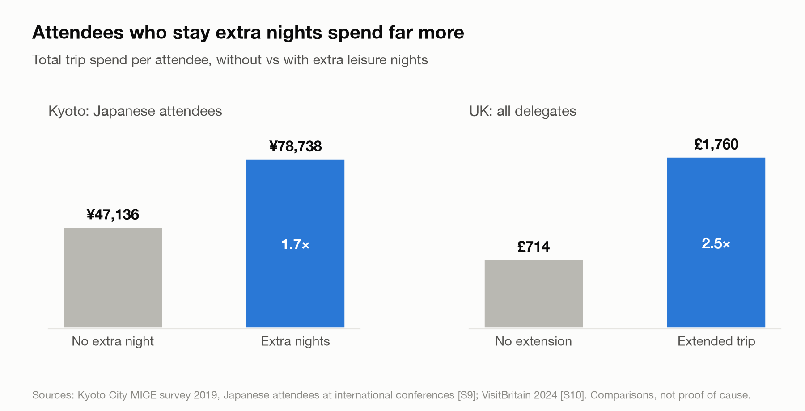
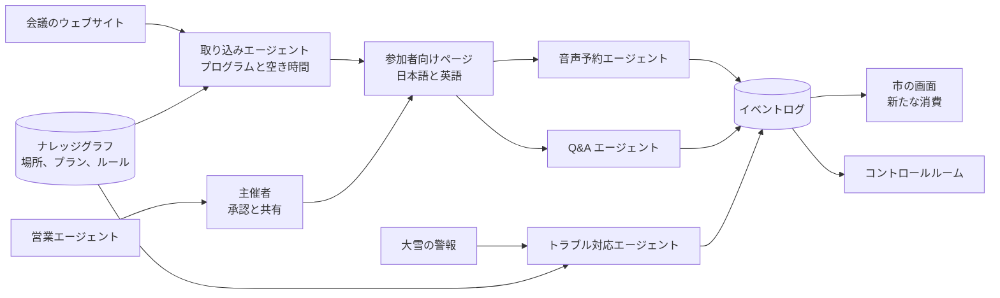
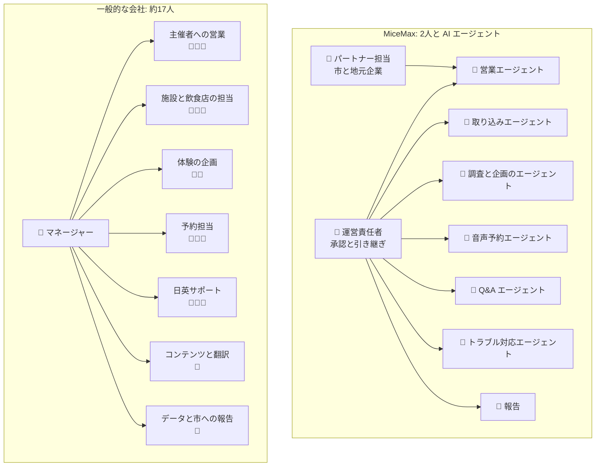

# MiceMax

*会議の参加者を地元のお客さんに変える、自律運営の会社。*

[English version](README.md)

**MICE** とは、会議(Meeting)、報奨・研修旅行(Incentive)、国際会議・学会(Convention)、展示会(Exhibition)の頭文字で、ビジネスイベントのための旅行を指します。MiceMax は、それが開催都市にもたらす効果を最大にします。

**MiceMax は、学会や国際会議で札幌を訪れる人に、地元でもっとお金を使ってもらうサービスです。** 会議のプログラムを読み取り、参加者の空き時間を見つけ、そこに合う地元の体験をすぐ予約できる形で届けます。会議後の温泉泊、ラーメンと夜景の夜、専門分野に関わる施設見学などです。

**札幌のすべての会議で使えば、地元での新たな消費は年間約3,300万円、最大1.7億円と見込んでいます。** 現在、札幌市は同じ取り組みを1つの会議について手作業で行うために399万円を支払っています。

**MiceMax は最先端の AI で運営する会社で、人は1〜2人だけです。** 運営費が低いため、小さな予算で札幌のすべての会議に対応し、次に道内の他都市、そして全国へ広げられます。

**デモ:** https://mice-max.netlify.app （[試し方](#5分で試す)）

## なぜ札幌か

札幌では2025年に466件の会議が開かれ、109,311人が参加しました(2024年は443件、89,211人)。国際会議の開催件数でも2024年は国内4位の、日本有数の会議都市です(国内会議の都市別ランキングは存在しません)。

**参加者の大半は日本人で、私たちの主な対象です。** 約94%が国内からの参加者で、多くは全国規模の医学系・学術系の学会に参加しています。

**道外からの訪問者の多くは、少数の大規模な全国大会が連れてきます。** 札幌コンベンションセンターでは、全国大会と国際会議は件数の10%ですが、参加者の26%を占めます。2025年のある全国大会では、参加者2,949人の83%が道外からでした。MiceMax が対象とするのはこうした訪問者です。

**札幌は会議の数を増やして成長することができません。** 札幌コンベンションセンターは2024年度に365件の予約を受けられず、新しい施設の開業は2033年度ごろの予定です。それまでは、参加者1人あたりの消費を増やすことが成長への道です。

## アイデア: 手間をなくす

参加者は会議のために来ます。慣れない街でそれ以外の予定を立てるのは手間なので、多くの人は飛行機で来て、会議に出て、そのまま帰ります。MiceMax は地元の友人のように予定を考え、すぐ予約できる形で渡します。

1. **まず延泊。** 「土曜は定山渓温泉に泊まりませんか。13:30に会場を出て、14:30のシャトルで、15:00にチェックイン」。最もはっきりした新たな消費です。この提案がなければ、参加者はそのまま帰るからです。
2. **空き時間の短い体験。** 二条市場での長めの昼食、藻岩山の夜景と味噌ラーメン、早朝ランと海鮮朝食など。
3. **専門的な見学。** 災害医学の学会なら札幌市民防災センターのように、その参加者だからこそ行きたい場所です。

どの提案も、参加者の実際の予定、営業時間、移動時間、最終バスに合わせてあるので、ワンクリックで参加できます。同じ会議の参加者と一緒に参加することもできます。主催者はリンクを1つ共有するだけで、市は何が予約され、どれだけ新たな消費が生まれたかを確認できます。

長く滞在する参加者ほど多く消費します。京都では、観光目的の泊を追加した日本人の会議参加者の旅行支出は1人78,738円で、追加しなかった人は47,136円でした。



## 市はすでにこの取り組みに予算を出している

2026年6月、札幌市は「[コンベンション参加者滞在促進プログラム開発業務](https://www.city.sapporo.jp/keizai/kanko/mice/r8convention_program.html)」を3,990,910円で委託しました。目的は「プラス1泊」を促す特別な体験づくりと、宿泊数・満足度・消費額の調査です。対象は**1つ**の会議で、手作業で設計されます。

さらに広げるための財源もあります。2026年4月に始まった札幌市の宿泊税は、観光向けに年間約27億円の税収が見込まれています。観光庁は、訪日ビジネス客の消費額を20%増やす目標を掲げています。

つまり、買い手も、予算も、目標もすでにあります。私たちは同じことをすべての会議で、自動で、効果測定つきで行うことを提案します。

## 私たちについて

私たちはプロダクトと AI のエンジニアで、10年近く AI プロダクトを作ってきました。地元企業により多くのお金を届ける札幌の取り組みの技術パートナーになりたいと考えており、MiceMax がその第一歩です。

## 新たな消費はいくらか

MiceMax がなければ使われなかったお金だけを数えます。

```
新たな消費 = 届いた参加者数
            × (体験を予約する割合 × 体験の支出 × 本当に新しい支出の割合
               + 延泊する割合 × 1泊あたりの支出)
```

中間シナリオでは、主催者を通じて年間約19,700人に届き、5%が1泊延泊し、25%が体験を予約します。合計は**3,340万円**です。参加者数以外の数値はすべて私たちの仮定です。最大の不確定要素は日本人参加者が延泊するかどうかなので、最初のパイロットでこれを検証します。参加者の半分には提案を見せ、残りの半分には見せずに比較します。

## AI で運営する会社

このようなサービスには通常、営業、地元の体験を企画する担当、予約担当、日英対応のサポートが必要です。MiceMax ではその仕事を AI エージェントが行い、人は判断が必要なときだけ関わります。

| 仕事 | AI が行うこと | 人の確認 |
|---|---|---|
| 顧客を見つける | 営業エージェントが今後の会議を順位づけし、主催者への日英メールを下書き | 送信前に人が承認 |
| 会議を準備する | 取り込みエージェントが会議サイトを9段階で読む: プログラム、セッション、空き時間、参加者層、合う体験、順位づけ、日英のページとメール | AI が自信のない候補は主催者が承認 |
| 体験を企画する | 調査エージェントが203か所、予約できるプラン96件、体験109件のナレッジグラフを構築(写真、価格、営業時間つき)。「3月は休業」「最終バスに間に合わない」など、合わない案はグラフが除外 | |
| 予約する | 音声エージェントが旅館や飲食店に日本語で電話し、予約内容を記録 | |
| 質問に答える | 参加者と主催者向けのチャット。その会議のデータだけをもとに回答 | 返金、医療上の配慮、苦情は人に引き継ぎ |
| トラブルに対応する | 雪で定山渓行きのバスが止まると、影響を受ける参加者を見つけ、代わりの案を選び、連絡し、旅館に電話 | |
| 報告する | コントロールルームで全エージェントの動きとコストを表示。市の画面では届いた人数、予約、新たな消費を表示 | |

### 全体の流れ



### 使っている技術

| 製品 | MiceMax での役割 |
|---|---|
| Claude Sonnet 5.5 | ライブのエージェントを動かす: 取り込み、営業、チャット、トラブル対応、予約電話の読み取り |
| Claude Opus 5.5 | 事前に用意する文章を書く: 電話の台本、回答例、トラブル時のメッセージ |
| OrcaRouter | すべての LLM 呼び出しの窓口。モデル間の振り分けと切り替え |
| Linkup | 会議サイトに日程や会場がないときのウェブ検索 |
| Neo4j Aura と RelateDB | 場所、プラン、参加者、予約のナレッジグラフ。トラブルの影響を受ける人を特定 |
| ElevenLabs Conversational AI | 予約の電話をかける日本語の音声エージェント |
| ElevenLabs 音声合成 | 録音した電話の音声 |
| Neon Postgres | 表示、予約、見送りをすべて記録するイベントログ。市の数値のもと |
| 国土地理院 住所検索 | 住所を地図上に置き、移動時間を計算 |
| SQLite、FastAPI、Astro、Render、Netlify | データ、バックエンド、ウェブサイト、ホスティング |

### 誰が仕事をするか

札幌全体でこのサービスを運営する一般的な会社なら、約17人が必要です(私たちの見積もり)。MiceMax は2人です。



## 5分で試す

https://mice-max.netlify.app を開き、役割を選んで好きな名前を入力してください(パスワードの確認はありません)。デモは実在の会議を使っています: 第32回日本災害医学会総会・学術集会(2027年3月、参加者約3,000人)。

| 開く | 見どころ |
|---|---|
| [参加者のカレンダー](https://mice-max.netlify.app/c/jadm32) | 実際のプログラム、空き時間、それに合う体験。1つ開いて予約できます(請求はありません) |
| [主催者の画面](https://mice-max.netlify.app/organize/jadm32) | 空き時間ごとの提案、参加人数、ワンクリックで削除、共有リンクと QR コード |
| [市の画面](https://mice-max.netlify.app/city) | 届いた参加者数、予約、延泊、新たな消費 |
| [コントロールルーム](https://mice-max.netlify.app/ops) | 各エージェントが何をし、いくらかかったか |
| [ライブ取り込み](https://mice-max.netlify.app/ops/run) | 会議のリンクを貼ると、エージェントが準備する様子を見られます |
| [運営](https://mice-max.netlify.app/ops/jadm32) | 旅館のスタッフ役で音声エージェントと話す。大雪のトラブルを起こす |
| [営業](https://mice-max.netlify.app/ops/sales) | 今後の会議に向けた営業メールの下書き |

会議のプログラム、場所、価格、写真は実在のものです。参加者、予約、市の数値はシミュレーションで、画面にもそう表示しています。

## 今後

1. **パイロット:** 2027年に札幌の実際の会議1件で実施。主催者は無料。比較グループと効果を比べます。
2. **札幌全体:** 市が支援するすべての会議へ。既存の滞在促進予算や観光予算から。
3. **北海道:** 函館、次に帯広。
4. **全国:** 観光庁が「グローバル MICE 都市」に選んだ他の11都市。

## 出典と詳細

上の数値の出典はすべて [docs/01-evidence.md](docs/01-evidence.md) と [docs/06-sources.md](docs/06-sources.md) にあります(英語)。詳しい資料は [docs/README.md](docs/README.md) から。開発者向け: [AGENTS.md](AGENTS.md)。
