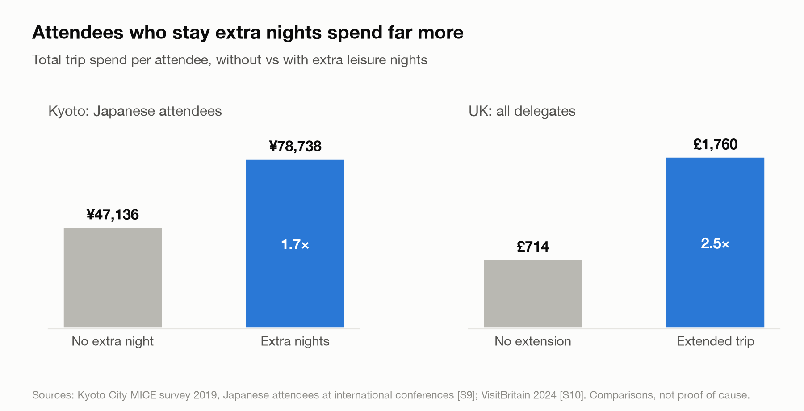
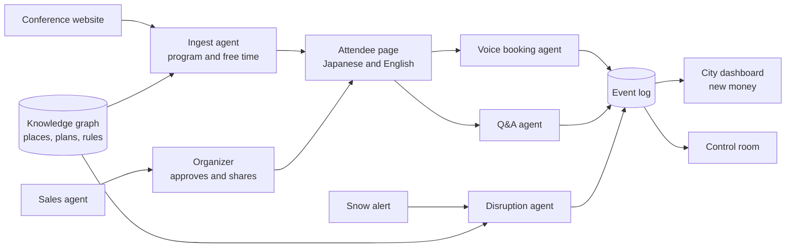
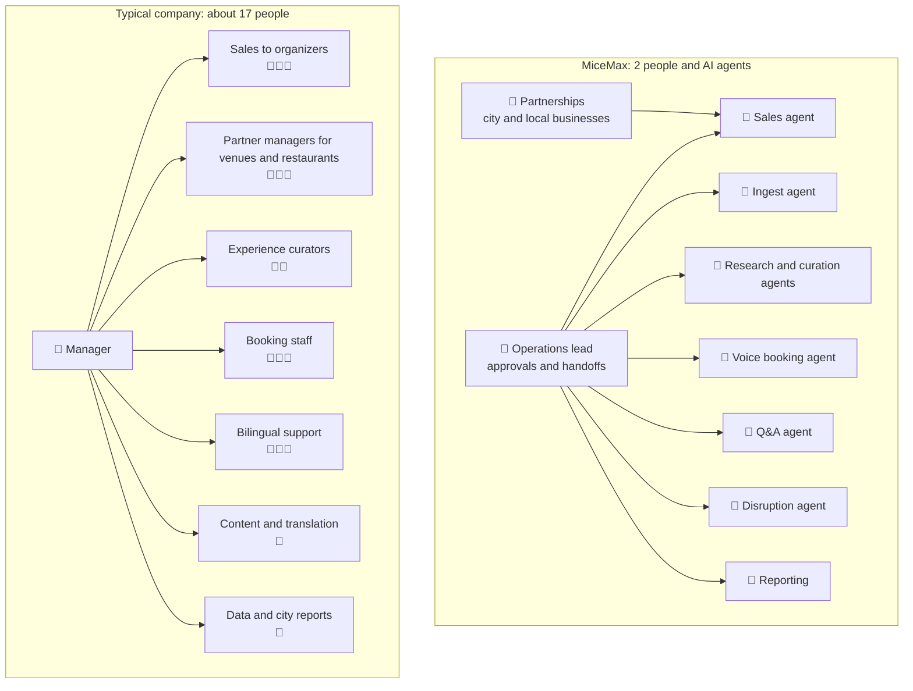

# MiceMax

*The autonomous company that turns conference visitors into local customers.*

[日本語版はこちら](README.ja.md)

**MICE** stands for meetings, incentive trips, conventions and exhibitions: travel for business events. MiceMax gets the most out of them for the host city.

**MiceMax gets people who come to Sapporo for conferences to spend more money locally.** It reads each conference's program, finds attendees' free time and hands them local experiences that fit, ready to book: an onsen night after the conference, a ramen and night-view evening, a visit tied to their field.

**Run across all of Sapporo's conferences, we estimate about ¥33M a year of new local spending, and up to ¥170M.** For comparison, the city now pays ¥3.99M to do this by hand for one conference.

**MiceMax is a company run by frontier AI, with one or two people.** Running costs stay low, so one small budget covers every conference in Sapporo, then other Hokkaido cities, then the rest of Japan.

**Live demo:** https://mice-max.netlify.app ([what to try](#try-it-in-5-minutes))

## Why Sapporo

Sapporo hosted 466 conferences and 109,311 attendees in 2025, up from 443 and 89,211 in 2024. It is also one of Japan's main conference cities: 4th for international meetings in 2024 (no national ranking exists for domestic meetings).

**Most attendees are Japanese, and they are our main market.** About 94% come from inside Japan, mostly to national medical and academic society meetings.

**A few large national meetings bring most of the visitors from outside Hokkaido.** At the main venue, national and international meetings are 10% of events but 26% of attendance. One 2025 national meeting had 83% of its 2,949 attendees from outside Hokkaido. These visitors are the ones MiceMax targets.

**Sapporo can't grow by hosting more conferences.** Its main venue turned away 365 bookings in FY2024, and the new venue opens around FY2033. Until then, the way to grow is more spending from each attendee.

## The idea: remove the friction

People come for the conference. Planning anything else is extra work in an unfamiliar city, so most fly in, attend and fly out. MiceMax plans it for them, the way a local friend would, and hands it over ready to book:

1. **An extra night first.** "Stay Saturday night at a Jozankei onsen: leave the venue 13:30, shuttle at 14:30, check in at 15:00." This is the clearest new money: without the offer, the attendee goes home.
2. **Short experiences in free time.** A long lunch at Nijo Market, Mt Moiwa night view then miso ramen, an early run then a seafood breakfast.
3. **Specialist visits** only this audience would want, like Sapporo's disaster-prevention center for a disaster-medicine meeting.

Each offer fits the attendee's real schedule, opening hours, travel time and last bus, so saying yes takes one click. Attendees can also join colleagues from the same conference. The organizer shares one link, and the city sees what was booked and how much new money came in.

Attendees who stay longer spend more. In Kyoto, Japanese conference attendees who added leisure nights spent ¥78,738 per trip, against ¥47,136 for those who didn't.



## The city already pays for this

In June 2026, Sapporo City awarded a ¥3,990,910 contract for a "Convention attendee stay-promotion program" ([コンベンション参加者滞在促進プログラム開発業務](https://www.city.sapporo.jp/keizai/kanko/mice/r8convention_program.html)). Its goal is special experiences that make attendees stay "+1 night", and a survey of nights, satisfaction and spend. It covers **one** conference, designed by hand.

Funding for more exists too. Sapporo's lodging tax, started April 2026, is expected to raise about ¥2.7B a year for tourism. The Japan Tourism Agency has set a goal of +20% spending by foreign business visitors.

So the buyer, the budget and the goal already exist. We offer to do the same for every conference, automatically, with measurement built in.

## Who we are

We are product and AI engineers who have built AI products for close to 10 years. We want to be Sapporo's tech partner for bringing more money to local businesses, and MiceMax is how we start.

## How much new money

We count only money that would not have been spent without MiceMax:

```
New money = attendees reached
            × (share who book an activity × activity spend × share that is truly new
               + share who stay an extra night × spend per extra night)
```

In the middle scenario, organizers reach about 19,700 attendees a year, 5% stay one extra night and 25% book an activity: **¥33.4M**. All inputs except the attendee count are our assumptions. The biggest unknown is whether Japanese attendees will add a night, so the first pilot tests that, with half the attendees seeing offers and half not.

## A company run by AI

A service like this normally needs sales staff, local curators, booking staff and bilingual support. In MiceMax, AI agents do that work and people only step in where judgment is needed.

| Job | What the AI does | Human check |
|---|---|---|
| Find customers | Sales agent ranks upcoming conferences and drafts Japanese and English emails to organizers | A person approves before anything is sent |
| Set up a conference | Ingest agent reads the conference website in 9 steps: program, sessions, free time, audience, fitting experiences, ranking, Japanese and English page and email | The organizer approves picks the AI is unsure about |
| Curate experiences | Research agents built a knowledge graph of 203 places, 96 bookable plans and 109 experiences, with photos, prices and opening hours. The graph rejects any idea that doesn't fit, such as "closed in March" or "misses the last bus" | |
| Book | Voice agent phones the ryokan or restaurant in Japanese and records the booking | |
| Answer questions | Chat for attendees and organizers, answering only from the conference's data | Refunds, medical needs and complaints go to a person |
| Handle problems | When snow stops the Jozankei bus, an agent finds affected attendees, picks alternatives, writes to them and calls the ryokan | |
| Report | Control room shows every agent step and its cost; the city view shows reach, bookings and new money | |

### How it fits together



### Technology we use

| Product | What it does in MiceMax |
|---|---|
| Claude Sonnet 5.5 | Runs the live agents: ingest, sales, chat, disruption, reading booking calls |
| Claude Opus 5.5 | Writes prepared content: call scripts, sample answers, disruption messages |
| OrcaRouter | One gateway for every LLM call, with routing and failover between models |
| Linkup | Web search when a conference website is missing dates or venue |
| Neo4j Aura and RelateDB | Knowledge graph of places, plans, attendees and bookings; finds who a disruption affects |
| ElevenLabs Conversational AI | Japanese voice agent that makes booking calls |
| ElevenLabs text to speech | Voices for recorded calls |
| Neon Postgres | Event log of every offer shown, booked or skipped; feeds the city numbers |
| GSI address search | Places addresses on the map, for travel times |
| SQLite, FastAPI, Astro, Render, Netlify | Data store, backend, website and hosting |

### Who does the work

A typical company running this across Sapporo would need around 17 people (our estimate). MiceMax needs two.



## Try it in 5 minutes

Open https://mice-max.netlify.app and pick a conference (the landing page is the attendee view; the tabs at the top switch to the other views). To sign in with a name, use https://mice-max.netlify.app/login — enter any name (there is no password check). The demo uses a real conference: the 32nd Annual Meeting of the Japanese Association for Disaster Medicine, March 2027, about 3,000 attendees.

| Open | What to look at |
|---|---|
| [Attendee calendar](https://mice-max.netlify.app/c/jadm32) | The real program, free-time windows and experiences that fit them. Open one and book (nothing is charged) |
| [Organizer view](https://mice-max.netlify.app/organize/jadm32) | Suggestions per free window, how many joined, one-click remove, share link and QR code |
| [City view](https://mice-max.netlify.app/city) | Attendees reached, bookings, extra nights and new money |
| [Control room](https://mice-max.netlify.app/ops) | Every agent, what it did and what it cost |
| [Live ingest](https://mice-max.netlify.app/ops/run) | Paste a conference link and watch the agents set it up |
| [Operations](https://mice-max.netlify.app/ops/jadm32) | Talk to the voice agent as the ryokan staff; trigger the snow disruption |
| [Sales](https://mice-max.netlify.app/ops/sales) | Outreach drafted for upcoming conferences |

Conference programs, places, prices and photos are real. Attendees, bookings and city numbers are simulated, and labelled so on screen.

## Next steps

1. **Pilot:** one real Sapporo conference in 2027, free for the organizer, measured against a comparison group.
2. **All of Sapporo:** every conference the city supports, paid from the existing stay-promotion and tourism budgets.
3. **Hokkaido:** Hakodate, then Obihiro.
4. **Japan:** the other 11 cities the Japan Tourism Agency names as Global MICE cities.

## Sources and details

Every number above is sourced in [docs/01-evidence.md](docs/01-evidence.md) and [docs/06-sources.md](docs/06-sources.md). The full briefs start at [docs/README.md](docs/README.md). Developers: [AGENTS.md](AGENTS.md).
