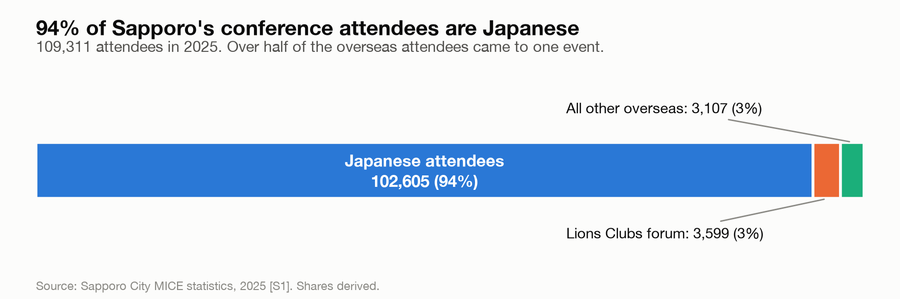
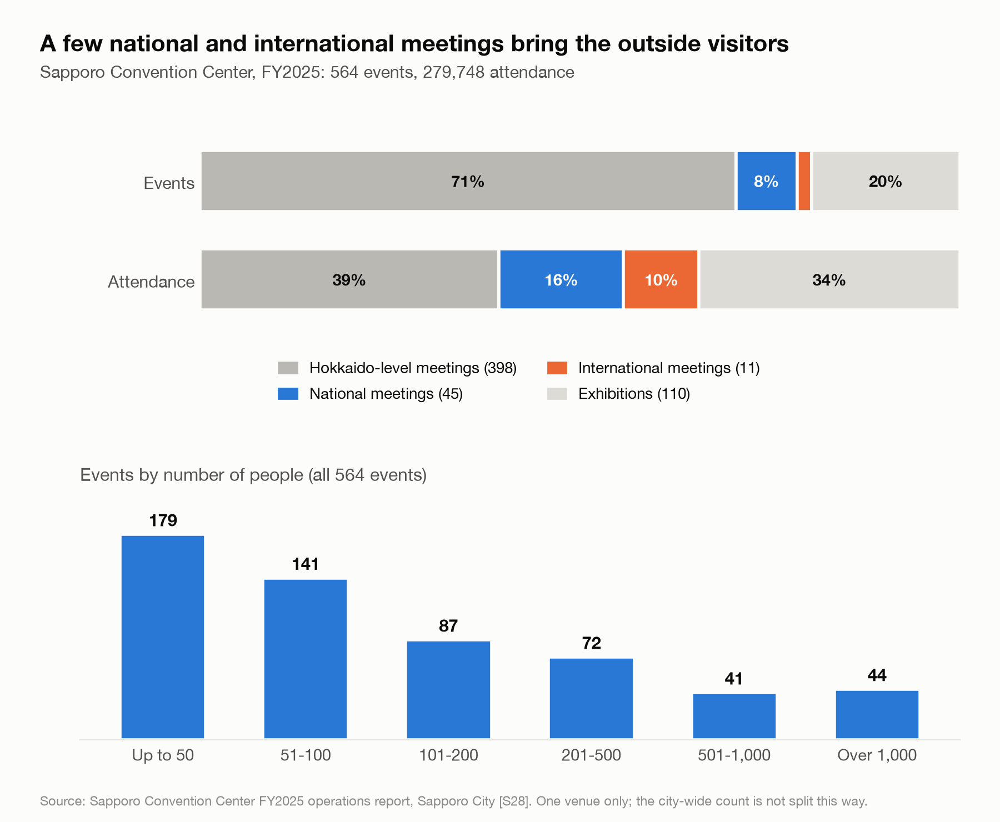
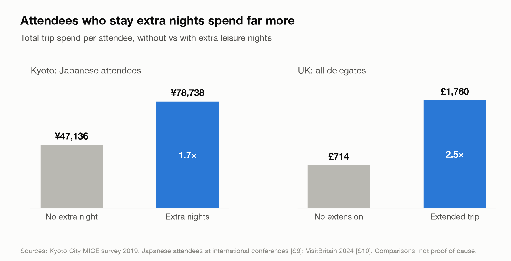

# MiceMax: evidence

What we know, how sure we are and where it comes from. Labels: **Checked** = we read it in the original source. **Reported** = news, a third party or a search summary. **Derived** = our arithmetic on sourced numbers. [Sx] = [06-sources.md](06-sources.md).

## The short version

1. Sapporo hosts about 466 conferences and 109,000 attendees a year. About 94% are Japanese.
2. Its main venue is full, and the new one won't open until about FY2033. **More spend per attendee is the only way to grow in the meantime.**
3. **The city already pays for exactly this:** a ¥3.99M contract in 2026 to design a "+1 night" program for one conference and survey stay and spend.
4. There is new money to fund it (Sapporo's lodging tax from April 2026) and a national goal pushing for it.
5. Attendees who stay longer spend clearly more. Whether we can *cause* them to stay longer, especially Japanese attendees, is not yet proven.

## 1. The market

| Fact | Number | Label |
|---|---|---|
| Conferences in Sapporo, 2025 (calendar year) | 466 | Checked [S1] |
| Attendees, 2025 | 109,311 | Checked [S1] |
| Attendees from overseas, 2025 | 6,706 (about 6%) | Checked [S1] |
| Japanese attendees, 2025 | about 102,600 (about 94%) | Derived |
| Same figures for 2024 | 443 conferences, 89,211 attendees, 3,509 from overseas | Checked [S1] |
| Average attendees per conference, 2025 | about 235 | Derived |

> Question: Why not include the number of conferences in Sapporo per year ? Gives a tangible proof of growth, beyond the venue limitation.

**How to read these numbers:**
- The city counts only attendees whose attendance was confirmed, so the true total is higher.
- These are the city's own counts. Don't compare them with JNTO (Japan National Tourism Organization) or ICCA (International Congress and Convention Association) rankings, which use stricter definitions.
- **The overseas jump from 2024 to 2025 is mostly one event.** The Lions Clubs forum in October 2025 brought 10,464 attendees, 3,599 of them from abroad (Checked [S1]). That one event is about 54% of 2025's overseas attendees. Without it, overseas attendance fell slightly from 2024 (Derived).
- **At the main venue, most events are small and local. The visitors we want come through a few big ones.** In FY2025, Sapporo Convention Center held 564 events. National and international meetings were only 10% of them (56 events) but brought 26% of all attendance. 44 events had over 1,000 people (Checked [S28]). This is one venue, not the whole city, and its count rose sharply from 322 events in FY2024 (Checked [S28]).

- **Most conferences are national Japanese academic and medical meetings (学会).** Of the city's 23 listed major conventions for FY2026, 11 are medical (Checked [S1]).
- **National meetings draw people from outside Hokkaido.** Example: a 2025 child-abuse prevention society meeting had 2,949 attendees, 83% from outside Hokkaido (Checked [S1]).

## 2. Why spend per attendee is the only lever right now

- Sapporo Convention Center could not accept 365 bookings in FY2024, and has turned away more than 300 a year for several years (Reported [S2]).
- The new MICE facility (for meetings, incentive trips, conventions and exhibitions), costing about ¥59.7B, aims to open in **FY2033** (Reported [S4]).
- So Sapporo can't grow by hosting more conferences for years. It can grow by earning more from each attendee.

## 3. The city already pays for this

In June 2026, Sapporo City's tourism and MICE section awarded a contract called the "Convention attendee stay-promotion program" (コンベンション参加者滞在促進プログラム開発業務) (Checked [S3]):

- **Amount:** ¥3,990,910 including tax, to Doshin EC (budget cap ¥3,993,000).
- **Goal, in the city's words:** create special experiences that motivate a **"+1 night" (プラス１泊)** stay, and so raise local economic benefit.
- **Scope:** one conference held in Sapporo between July 2026 and February 2027. National conferences qualify if they have 500+ on-site attendees and at least 50% from outside Hokkaido. International ones need 100+ attendees, including 20+ from overseas.
- **Measurement required:** a survey of nights stayed, satisfaction and spend, plus a report on how to reuse the approach.
- **Limit:** the contract money cannot pay for attendees' lodging or meals. Attendees pay for those themselves.

**Why this matters:** the buyer, the budget line, the goal and the way of measuring it already exist. We don't need to convince the city the problem is real. Our pitch is doing it for every conference, automatically, with better measurement.

## 4. New money and national pressure

- **Sapporo lodging tax:** started 1 April 2026 (Checked [S5]). Expected to raise about ¥2.7B a year, used for tourism (Reported [S5]).
- **National goal:** the Japan Tourism Agency (観光庁) has set a new target of **+20% spend by foreign business visitors** (Checked [S6]).
- **Its own diagnosis:** at a typical conference, attendees stay only in the host city, leave without discovering the region, rarely want to come back, and "local spend is also low" (地域での消費額も少ない) (Checked [S6]).

## 5. What attendees do and want

**Japanese attendees (our main users):**
- A Japanese conference attendee spent about ¥55,000 per trip on average, and about ¥77,000 when the event was outside Tokyo, Osaka and Nagoya (FY2016, Reported [S8]).
- We have no Sapporo-specific survey of Japanese attendees' free time or spending. This is a gap (see [05-decisions-and-open-questions.md](05-decisions-and-open-questions.md)).

**Overseas attendees** (national survey of visitors to Japan for business events) (Checked [S7]):
- Their #1 interest is **eating Japanese food (37.2%)**, versus 29.1% for all tourists.
- **41.5% travel alone and 41.0% with colleagues.** This supports group dinners and "join others".
- In a Japan Tourism Agency pilot survey, the **conference's own website was their #1 source of information about Japan (about 35%)**, and about 60% brought a companion (Checked [S6]). This supports distributing through the organizer.

## 6. Extra nights bring in more money

- **Kyoto (2019 survey of attendees at international conferences, 984 people):** Japanese attendees who added non-conference nights spent **¥78,738** in total, versus **¥47,136** for those who didn't. They stayed 4.4 nights versus 2.2 (Checked [S9]). That is about ¥31,600 more over about 2.2 more nights, or about ¥14,000 per extra night (Derived).
- **Warning from the same survey:** foreign attendees added leisure nights **more than 6 times as often** as Japanese attendees (Checked [S9]). Getting Japanese attendees to stay longer may be hard.
- **UK (VisitBritain, 2024):** delegates who extended their trip for leisure spent **£1,760**, versus **£714** for those who didn't, about 2.5 times as much (Reported [S10]).
- **Caution:** both are comparisons, not experiments. People who choose to stay longer may simply be bigger spenders. Only our own pilot can show that an offer *causes* extra nights.

## 7. Specialist experiences attract some attendees

At URSI GASS 2023 in Sapporo (1,434 attendees from 49 countries and regions), the Convention Bureau helped run a 3-day trip to a research radar site in Rikubetsu. **32 people from 12 countries joined, about 2.2% of attendees** (Checked [S11], Derived). It is one example, but it is real, observed uptake for a specialist trip.

## 8. What the evidence does not show yet

- Whether attendees, especially Japanese ones, will add an extra night because of an offer.
- Whether attendees have free evenings, or whether receptions and sponsor events fill them.
- Whether organizers will share our link.
- How much activity spend is truly new rather than moved from one shop to another.
- Whether the city will pay for software rather than a hand-built program.

Each one, and how to test it, is in [05-decisions-and-open-questions.md](05-decisions-and-open-questions.md).
