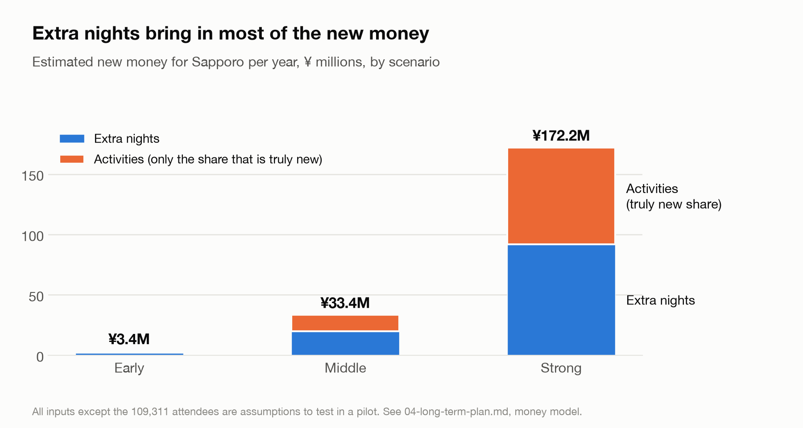

# MiceMax: long-term plan

This covers where MiceMax goes after the hackathon, who pays, who we compete with and how we work out how much new money it brings in. Labels: **Checked** = read in the original source. **Reported** = news or third party. **Derived** = our arithmetic on sourced numbers. **Assumption** = our estimate. [Sx] = [06-sources.md](06-sources.md).

## Stages

| Stage | What | Who pays | Proof we need before moving on |
|---|---|---|---|
| 0. Hackathon | Working demo on two real conferences | – | Judges and city contacts understand it in under 5 minutes |
| 1. Pilot | One real Sapporo conference in 2027, free for the organizer. Real activity list, bookings confirmed by hand by a Japanese-speaking team member | Nobody yet. Optional small grants | Real numbers: reached → booked → extra nights → spend, plus a comparison group (see below) |
| 2. Sapporo | Run it for every conference the city supports | City MICE section (the existing stay-promotion budget), the DMO (lodging tax), commissions | The city renews, or budgets for all conferences instead of one |
| 3. Other Hokkaido cities | Same product for conferences already going to **Hakodate**, then **Obihiro** | Each city's tourism budget; national Japan Tourism Agency (観光庁) MICE projects, if a new round opens | Same results outside Sapporo |
| 4. Other Japanese conference cities | The other 11 "Global MICE cities" named by the Japan Tourism Agency: Sendai, Tokyo, Chiba, Yokohama, Nagoya, Osaka, Kobe, Kyoto, Hiroshima, Fukuoka, Kitakyushu (Checked [S21]) | Each city's convention bureau or DMO | Repeatable sale to a second big city |

**National money:** in FY2026 the Japan Tourism Agency ran a regional MICE project worth up to ¥10M for host cities and up to ¥20M for projects in regions outside them. A city, convention bureau or DMO applies with partners. The FY2026 round closed in March 2026; a FY2027 round is not confirmed (Reported [S15]).

**Why Hakodate next:** it is Hokkaido's only real second conference market. It hosts about 39 conventions with about 27,000 attendees a year (Reported [S17]), including the Arctic Science Summit Week in April 2027 with about 600–700 international researchers (Reported [S18]). From April 2026 it has its own lodging tax (about ¥383M a year), and its FY2026 budget has a new line for early-morning and night-time tourism (¥6.27M) (Checked [S16]).

**Why other Japanese cities matter most:** Hokkaido alone is too small to support a company (see "Revenue to MiceMax" below). Every major Japanese conference city has the same problem and similar budgets.

## Money model

### What we measure

We count only **new money**: spending that would not have happened without MiceMax. A dinner that would have happened anyway, just at a different restaurant, does not count.

```
New money = Attendees reached
            × [ (share who book an activity × average activity spend × share that is truly new)
              + (share who stay an extra night × spend per extra night) ]

Attendees reached = Total attendees × share from outside the city × share the organizer reaches
```

Extra-night spend is counted in full, because without the offer the attendee would have gone home. To avoid double counting, an activity booked during an extra night is counted once, inside the extra-night spend.

### Scenarios for Sapporo (one year)

Starting point: **109,311 attendees** in 2025 (Checked [S1]). Everything else is an **Assumption** to be replaced by pilot data.

| | Early | Middle | Strong |
|---|---|---|---|
| Share from outside the city | 60% | 60% | 70% |
| Share the organizer reaches | 10% | 30% | 60% |
| **Attendees reached** | **6,559** | **19,676** | **45,911** |
| Share who book an activity | 15% | 25% | 35% |
| Average activity spend | ¥5,000 | ¥7,000 | ¥10,000 |
| Share of activity spend that is truly new | 30% | 40% | 50% |
| Share who stay an extra night | 2% | 5% | 8% |
| Spend per extra night | ¥15,000 | ¥20,000 | ¥25,000 |
| **New money from activities** | ¥1.5M | ¥13.8M | ¥80.3M |
| **Extra nights** | 131 | 984 | 3,673 |
| **New money from extra nights** | ¥2.0M | ¥19.7M | ¥91.8M |
| **Total new money for Sapporo** | **¥3.4M** | **¥33.4M** | **¥172.2M** |



What the assumptions rest on:
- *Share from outside the city:* the city's own stay-promotion program targets national conferences with at least 50% of attendees from outside Hokkaido (Checked [S3]). One 2025 example had 83% (Checked [S1]).
- *Spend per extra night:* in Kyoto, Japanese attendees who added non-conference nights spent about ¥31,600 more over about 2.2 more nights, so about ¥14,000 per extra night (derived from Checked [S9]). An onsen or Otaru night likely costs more, so the scenarios go up from there. Also see the UK figure in [01-evidence.md](01-evidence.md).
- *Share who stay an extra night:* the biggest unknown. In the same Kyoto survey, foreign attendees added leisure nights more than 6 times as often as Japanese attendees (Checked [S9]). Domestic attendees may be hard to keep for an extra night. The pilot must test this first.
- *Share who book a specialist experience:* the one real example we have is 2.2% (32 of 1,434 attendees at URSI 2023, Checked [S11]). We fold specialist experiences into "activities" until we have more data.

Extra nights produce most of the new money in every scenario, which is why they come first. But this only holds if domestic attendees actually stay, which is unproven.

### How we prove it is new money

The city's own program already asks for a survey of stay, satisfaction and spend (Checked [S3]). We go further:

1. **Ask first.** At registration, before showing any offers, ask attendees when they plan to leave.
2. **Compare.** Show MiceMax offers to half of the attendees (or half of the email batches), and normal organizer information to the other half.
3. **Count.** Compare actual departure dates, bookings and spend between the two groups. Use booking records, confirmations from the businesses and a short post-event survey.
4. **Repeat.** One conference may be too small to show a clear difference. Plan on combining results from several.

### Revenue to MiceMax

The new money goes to local businesses, not to us. Our income is a small part of it. All prices below are **Assumptions to test**.

| Who pays | For what | Price to test |
|---|---|---|
| City / DMO / Convention Bureau | Running MiceMax for all supported conferences, plus the spend report | ¥2–5M per city per year. Sapporo already pays ¥3.99M for one hand-built program (Checked [S3]) |
| Businesses | Bookings we send them | Activities: about 10–20% commission (Reported [S19]). Restaurants in Japan usually pay a flat ¥200–440 per guest, not a percentage (Reported [S19]) |
| Organizers | A branded attendee page | Free at first. Later ¥50k–200k per event |
| Sponsors | Placements on the attendee page | Per campaign |

**Honest read:** in Sapporo alone, commissions at the "Middle" scenario come to a few million yen a year. That is not a business on its own. The business is **city contracts across many cities**, with commissions on top. This is why stage 4 matters.

## Customers

| Who | What they want | Role |
|---|---|---|
| Sapporo City tourism and MICE section | Longer stays and more spend from conference visitors, with proof | **First paying customer.** Already runs and funds this goal |
| DMO and lodging-tax budget | Tourism programs that show results | Second budget source in each city |
| Convention Bureau | Happy organizers, more conferences won | Gives access to organizers |
| Organizers and PCOs | A better event at no extra work or cost | **Distribution.** They send our link in registration emails |
| Local businesses | Customers on quiet nights and weekends | Supply, and commission income |

## Competitors and existing services

| Who | What they do | Where MiceMax differs |
|---|---|---|
| Doshin EC (current city contractor) | Built the city's 2026 "+1 night" program by hand for one conference (Checked [S3]) | Software for every conference, with automatic measurement. **More likely a partner than a rival**: they have local relationships, we have the technology |
| Sapporo Convention Bureau | Supports organizers with grants, itineraries and supplier introductions | No sign that it sells to attendees directly or measures their spend. City grants for organizers exclude food and drink (Reported [S20]) |
| PCO excursion desks (JTB, Nihon Convention Service and others) | Pre-booked group tours on fixed dates, with minimum headcounts (Reported [S23]) | Small groups, short activities, same-day and extra-night plans |
| Confit (Japanese conference registration app) | Lets attendees buy banquet and excursion add-ons (Reported [S22]) | Closest possible rival. Could add local offers. Also a possible partner |
| Klook, Tabelog, Hot Pepper and other booking sites | General activity and restaurant booking | Don't know the conference schedule or audience. We can link to them |
| Other cities' delegate programs (Sendai, Singapore, Obihiro) | Discounts or coupons for conference attendees (Reported [S12–S14]) | None publishes results. Measurement is the open gap |

## Risks to the plan

- **The city budget is small and short.** About ¥4M for a one-year contract. Whether it repeats in FY2027 is unconfirmed; the FY2026 call opened in April and closed in late May (Checked [S3]). Only firms on the city's FY2026–29 registered supplier list (advertising category) could bid, and proposals involving buses or lodging also needed travel agency registration (Checked [S3]). We may need to bid with or through a registered partner.
- **Legal limits.** Selling a bundle that includes transport or lodging probably needs travel agency registration. Linking to providers, or booking activities and meals without transport, generally does not (Reported [S24]). Get a licensed administrative scrivener (行政書士) to confirm before taking real payments.
- **Everything in "Unknowns" in [05-decisions-and-open-questions.md](05-decisions-and-open-questions.md).**
