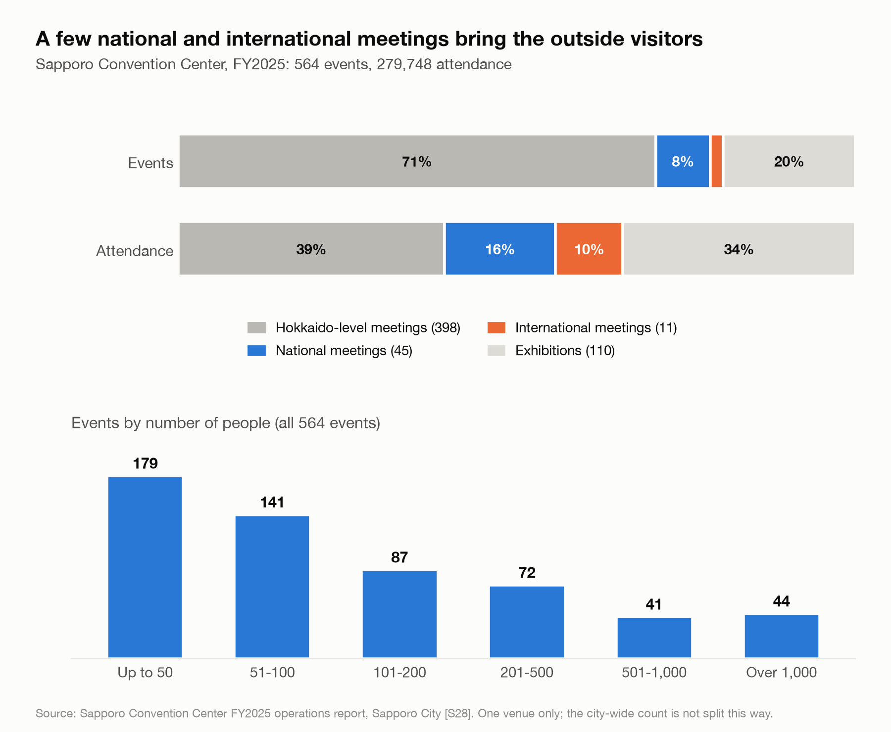
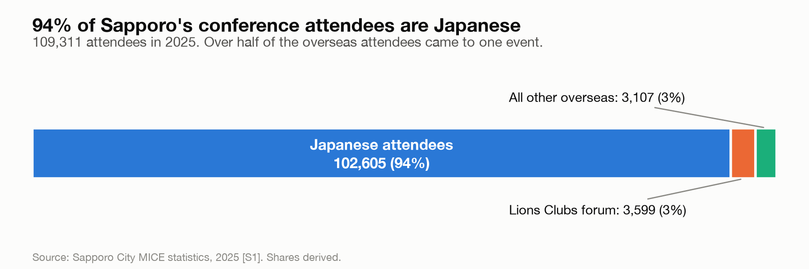
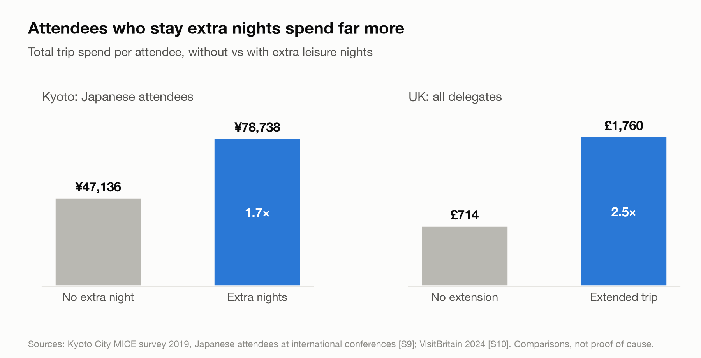
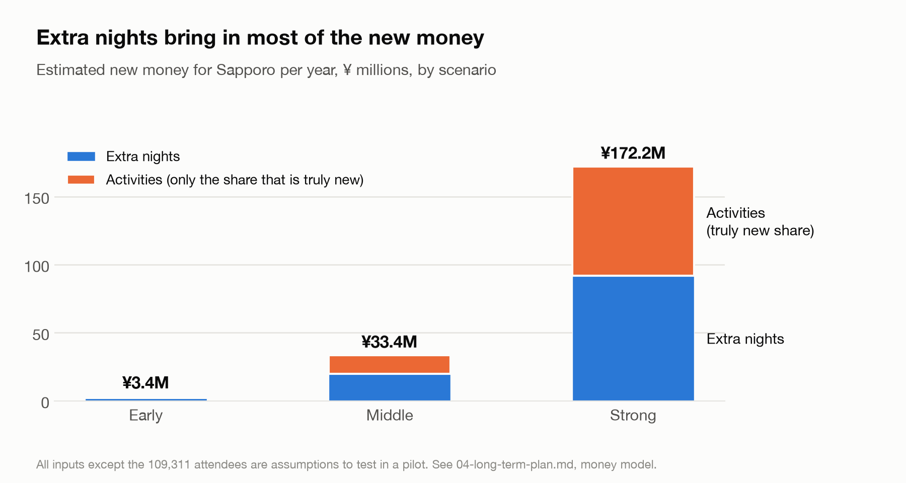

# MiceMax

Briefs for MiceMax, a product that gets people visiting Hokkaido for business events (meetings, incentive trips, conventions and exhibitions, known together as **MICE**) to spend more money here. Written November 2026 for a 2-day hackathon in Sapporo, and meant to hold up beyond it.

## The idea in five lines

1. Sapporo hosts about 109,000 conference attendees a year, but its venue is full until about FY2033, so it can't grow by hosting more conferences.
2. The only way to grow is to earn more from each attendee, and the city already pays to try this by hand for one conference a year.
3. MiceMax reads a conference's website, finds attendees' free time and offers them plans that fit: **an extra night first**, then short activities and evenings, then specialist visits.
4. The organizer shares it with one link, attendees book, and the city sees how much new money came in.
5. We start in Sapporo, then other Hokkaido cities, then Japan's other big conference cities.

## At a glance

To redraw the charts after changing a number: `python charts/make_charts.py` (needs matplotlib).

## Read in this order

| File | What it answers | Read time |
|---|---|---|
| [02-vision.md](02-vision.md) | What MiceMax is and who it's for | 3 min |
| [01-evidence.md](01-evidence.md) | Why we believe the problem is real, with every number sourced | 6 min |
| [03-hackathon-scope.md](03-hackathon-scope.md) | Exactly what we build in 2 days, and what we don't | 5 min |
| [04-long-term-plan.md](04-long-term-plan.md) | Stages after the hackathon, money model, customers, competitors | 7 min |
| [05-decisions-and-open-questions.md](05-decisions-and-open-questions.md) | What we decided and why; what we still don't know and how to find out | 4 min |
| [07-data-plan.md](07-data-plan.md) | What data the demo needs and the tasks to build it | 5 min |
| [08-outreach-plan.md](08-outreach-plan.md) | Who we contact during the hackathon, what we ask, how it shows in the demo | 4 min |
| [09-ui-plan.md](09-ui-plan.md) | The screens to build, shared foundations, event data schema, tech stack | 5 min |
| [06-sources.md](06-sources.md) | Every source, numbered [S1]–[S28] | Reference |
| [charts/](charts/) | The four charts above and the script that draws them | Reference |
| [prompts/inventory-research.md](prompts/inventory-research.md) | Prompt for the AI agent that builds the activity and venue list | Reference |

**If you are an AI agent building the product:** read [03-hackathon-scope.md](03-hackathon-scope.md) first, especially "Rules for agents building this". Then read [05-decisions-and-open-questions.md](05-decisions-and-open-questions.md).

## How sure are we?

Every number in these briefs carries a label:

- **Checked:** we read it in the original source.
- **Reported:** it comes from news, a third party or a search summary.
- **Derived:** our own arithmetic on sourced numbers.
- **Assumption:** our estimate, to be replaced with real data.

If you add a number, add a label and a source.

## Words used in these briefs

- **MICE:** meetings, incentive trips, conventions and exhibitions, i.e. business events.
- **PCO:** professional conference organizer, the company that runs a conference for the association that owns it.
- **DMO:** destination marketing organization, the body that promotes tourism in a city or region.
- **Convention Bureau:** the city-backed organization that attracts and supports conferences (Sapporo Convention Bureau).
- **Extra night:** a night an attendee stays beyond what the conference needs.
- **New money:** spending that would not have happened without MiceMax.
